<h1 align="center">Cheikh Oumar DIALLO</h1>

<b>DevSecOps · Mobile (Flutter) · Builder</b> Based in Senegal 🇸🇳 · Learning in public, shipping in private — until it's ready.

  

> Most of my work lives in private repos. Each row above is one of them: name redacted, stack and last activity visible.
> The day a repo goes public, it flips to **DECLASSIFIED** automatically.
> Forks only appear (**◆ FORK +N**) when I've shipped real commits on top of upstream, e.g. [vlc-android](https://github.com/seexumar/vlc-android) with YouTube link download.

### Clearance
| | |
|---|---|
| **Security & Ops** | Docker · Jenkins · Terraform · CI/CD · secure coding |
| **Mobile** | Flutter · Dart · BLoC · Clean Architecture |
| **Web & Backend** | TypeScript · Java / Spring Boot · Python · Astro |

### Declassified so far
- [flutter-clean-archi](https://github.com/seexumar/flutter-clean-archi) — Clean Architecture template for Flutter
- [BLoC-Method_Channel](https://github.com/seexumar/BLoC-Method_Channel) — BLoC + platform channels reference
- [llm-devops-project](https://github.com/seexumar/llm-devops-project) — infrastructure as code (HCL)
- [MagicCleaner](https://github.com/seexumar/MagicCleaner) — image enhancement model

Generated daily by [`generate.py`](generate.py) via GitHub Actions. Private repo names never leave GitHub: only a redaction bar, language and date are published.
